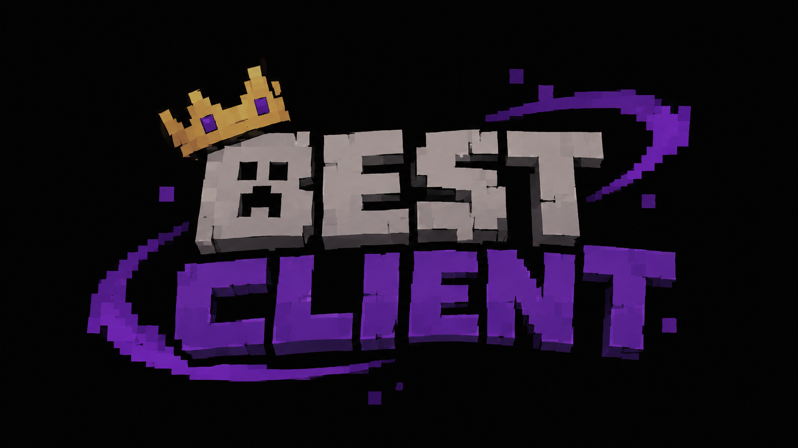

<!DOCTYPE html>
<html lang="en">
<head>
    <!-- Discord / Social Meta -->
    <meta property="og:site_name" content="Best Client">
    <meta property="og:type" content="website">
    <meta property="og:image" content="assets/resources/icon.png">
    <meta property="og:title" content="Best Client — Home">
    <meta property="og:url" content="https://bestclient.com">
    <meta name="theme-color" content="#913de2">
    <meta property="og:description" content="The official website for Best Client.">

    <meta charset="utf-8">
    <link rel="icon" href="assets/resources/icon.png">
    <meta name="viewport" content="width=device-width, initial-scale=1">
    <title>Best Client</title>

    
</head>
<body>

    <nav>
        
        

            <a href="index.html">Home</a>
            <a href="faq.html">FAQ</a>
            <a href="https://github.com" target="_blank">GitHub</a>
        

        

            <button type="button" class="login-btn" disabled>Login</button>
            Currently Disabled
        

    </nav>

    

        

            
            <h1 class="hero-title">BEST CLIENT</h1>
        

        

            <a href="https://discord.gg/6cdECSYEbC" target="_blank" class="button" style="background-color: var(--discord);">Discord</a>
            <a href="https://paypal.com" target="_blank" class="button" style="background-color: var(--paypal);">Donate</a>
        

    

    

        <h2>Downloads</h2>
        

            
Downloads: <strong>0</strong>

            
Online Players: <strong>0</strong>

        

        

            <a href="#" class="button">Download Best Client [Latest]</a>
            <a href="#" class="button">Download Addon / Baritone</a>
        

        
Looking for older versions? Check out the <a href="archive.html">archive</a>.

        
* Make sure you have the correct mod loader installed before launching Best Client.

    

    

        <h2>Dev Team</h2>
        

            

                
                
<b>Turbs</b>

                Owner / Head Developer
            

            

                
                
<b>ExtemeDmon</b>

                Twin
            

        

        

            <a href="https://discord.gg/6cdECSYEbC" target="_blank" class="button" style="background-color: var(--discord);">Discord</a>
            <a href="https://github.com" target="_blank" class="button" style="background-color: var(--github);">GitHub</a>
            <a href="https://youtube.com" target="_blank" class="button" style="background-color: var(--youtube);">YouTube</a>
            <a href="https://paypal.com" target="_blank" class="button" style="background-color: var(--paypal);">Donate</a>
        

    

    <footer>
        
Copyright © 2026 Best Client Development

        
All Rights Reserved.

    </footer>

</body>
</html>
